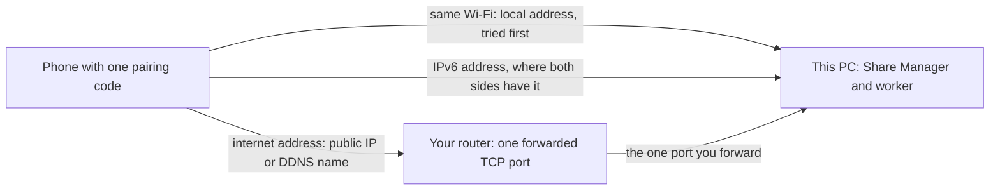

# Ways to connect your devices - where each is explained

Developer-facing index for **Fast Media Sorter & Sharing for Windows**. It answers three questions for anyone
who changes, documents or supports the connection features: which ways of connecting exist, what state each
is in on the Windows side, and which page or contract owns the explanation. It does not explain the ways to
readers - the shared portal does - and it never restates a contract.

Status is written as of 2026-10-10. The latest release is v26.9.20.1206 (2026-09-20); everything under
`[Unreleased]` in [CHANGELOG.md](../../CHANGELOG.md) is in the development tree only.

## 1. The three ways at a glance

| Way | Windows state | Reader-facing page (portal) | Governing contracts | Windows implementation |
| --- | --- | --- | --- | --- |
| **Home network** - this PC is the SFTP server, the phone connects straight to it, at home or through the router | **Shipped** | [Home network](https://serzhyale.github.io/FastMediaSorter_mob_v2/docs/media-exchange-portal/home-network.html), [Windows servers](https://serzhyale.github.io/FastMediaSorter_mob_v2/docs/media-exchange-portal/windows-servers.html) | `SHARE-SESSION`, `FMSCFG`, `ANYWHERE-ACCESS` (descriptor and third-party port), `WORKER-IPC` | Share Manager, the Go share worker, the Server edition service |
| **Exchange server** - one account, every device dials out to a server, folders listed in one place | **Client half built, its gate open since 2026-10-14** (specification 223); **the server binary is in no release package** (`INCLUDE_EXCHANGE` is `'false'` in `release.yml`, checked 2026-10-16); the wire is `DEVICE-EXCHANGE` 1.1 (registry `partial 1.1`); no joint run on a physical test host has happened (205) | [Exchange server](https://serzhyale.github.io/FastMediaSorter_mob_v2/docs/media-exchange-portal/exchange-server.html) (not published until the Android site publishes) | `DEVICE-EXCHANGE`, `ANYWHERE-ACCESS` section 5.5 | `exchange-server/` (Go), the Share Manager's server administration, the Windows device agent |
| **Live broadcast** - a phone or a watch goes on air, other devices listen | Receiving in the viewer and broadcasting from a Windows PC (the Share Manager: screen, camera, microphone, system sound): **built, gate open** (`LiveBroadcastFeatures.Offered`); the section 6 handshake and the acceptance on a second device have not been run (registry `partial 1.0`). Playing live broadcasts on Windows also: **STREAMS Player**, a separate program | [Live broadcast](https://serzhyale.github.io/FastMediaSorter_mob_v2/docs/media-exchange-portal/live-broadcast.html) | `LIVE-BROADCAST`, `DEVICE-EXCHANGE` (relay and Cast) | the viewer's "Open live broadcast.." (consumer and receiver), the Share Manager (producer) |

The portal start page, which puts the ways side by side, is
[Media exchange between your devices](https://serzhyale.github.io/FastMediaSorter_mob_v2/docs/media-exchange-portal/).
Windows-site pages and READMEs link only the start page, the home network page, the Windows servers page and,
where it fits, the live broadcast, clouds and editions pages; the exchange server page is linked from
developer-facing files like this one and from program UI that sits behind the exchange component, because
specification 249 (2026-10-20) lets the public site name the exchange server as the third component, always marked as in development and never linked to a download.

The contracts are cited by id. Their local pointers - what this repository holds and owes - are
[ANYWHERE-ACCESS](../contracts/ANYWHERE-ACCESS.md), [DEVICE-EXCHANGE](../contracts/DEVICE-EXCHANGE.md),
[LIVE-BROADCAST](../contracts/LIVE-BROADCAST.md), [SHARE-SESSION](../contracts/SHARE-SESSION.md) and
[FMSCFG](../contracts/FMSCFG.md).

## 2. Home network - what is true today

This is the way the public guide [publish-folders-android.html](../../publish-folders-android.html) documents.

- **Who serves.** The Share Manager (the tray program of the full package) drives a bundled Go SFTP worker. Each
  shared folder has a name you give it, read-only or writable, an optional PIN, media-type filters and a
  slideshow interval (`.fmscfg` schema 2 parameters). Only added folders are visible; the worker confines every
  session to them.
- **Off until you turn it on.** Nothing listens until server features are enabled: the installer checkbox, or the
  one-time button in the Share Manager (one UAC prompt that adds one program-scoped inbound firewall rule).
  Never silent, never at install by default, removed on uninstall.
- **Pairing.** A QR code or a `.fmscfg` file (also by e-mail or as clipboard text). One code carries all the
  PC's addresses: the local Wi-Fi/LAN address, the IPv6 address, and the internet address (public IP or DDNS name
  plus the forwarded port). The Android app races them and prefers the fast local one, so one scan works at home
  and away. The "local network only" switch leaves only the local address in the code and stops any router port
  opening.
- **Identity.** The ed25519 host key is generated once and pinned by the phone at the first pairing (trust on
  first use). An update, a restart or a switch of edition never regenerates it (`SHARE-SESSION` guarantee 3).
- **Rediscovery.** On the same Wi-Fi the phone finds the PC again by host-key fingerprint through mDNS
  (`_sftp-fms._tcp`), even when the PC's address changed.
- **The port.** Chosen once on the first start and then never moves on its own; the owner may set it. The bind
  is retried for about two seconds; a port that cannot be bound leaves the server down and says so. The router
  forwarding rule and the printed QR therefore stay valid. The firewall rule is program-scoped, so a port change
  needs no elevation.
- **Router help.** The Share Manager tries to open the port through UPnP or NAT-PMP when the router allows it
  (skipped in "local only"), then checks the port from outside and words the answer honestly: it works from the
  internet, the port does not answer (check forwarding), or the router opened it but the provider blocks
  incoming connections. It also finds the router address, offers an "Open router" button and warns about carrier
  NAT.
- **Always on.** The Server edition (own installer, winget `SerZhyAle.FastMediaSorter.Server`, page `server.html`)
  hosts the same worker as a Windows service that starts at boot. Same SFTP, same pairing, same host key. The
  service and the interactive worker never run together; the service wins. A full package can switch itself to
  service mode (Manager settings, Hosting). The Store build is user mode only.
- **Any client.** WinSCP, FileZilla or a file manager open the folders; the Share Manager shows address, port,
  login, password and the host-key fingerprint with copy buttons.
- **Floor.** Sharing needs the 64-bit mainline (Windows 10 1607+); the 32-bit fallback viewer cannot share.

In the development tree only: the viewer opens SFTP servers (a NAS, another PC's Share Manager, a phone's
built-in SFTP server) from the Resources list and exports a saved server as `.fmscfg`; the Share Manager shares
FileDO `.fdd` virtual disks as SFTP folders.

## 3. Exchange server and device agent - development tree only

All of this is behind the shipping gate (`INCLUDE_EXCHANGE`, off) and an unchecked installer component, and
nothing from it is in any released installer, ZIP or package until rung 2 freezes the wire. The first real run on
a physical test host has not happened.

- **Server.** `exchange-server/` builds `fms-exchange-server.exe`, a Go program that runs on Windows and also
  builds for Linux; see [exchange-server/README.md](../../exchange-server/README.md). Whoever runs a server is its
  operator.
- **Share Manager.** The administration lives in the Share Manager (accounts, devices, public endpoint,
  certificate, the "use this PC as my server" wizard, the Windows service).
- **Device agent.** A Windows PC enrols into an account, publishes its shares and lists and opens the folders of
  other devices.
- **What may be said as "will", because the contract fixes it.** Accounts with a salted password hash
  (Argon2id); device tokens stored only as SHA-256; a directory of folders and broadcasts; one port with three
  openings; TLS with a pinned self-signed identity; tunnels joined without reading the bytes; third-party SFTP
  clients reaching a published folder through a per-resource port; a fan-out relay (one upload, many
  listeners, a window of two seconds, a slow listener skips ahead); Cast as offer and answer, where the receiver
  asks before it plays; a user log with hashed identifiers and no secrets; a statement of what the operator can
  see. Use "in the development version" or "arrives with a later release" for anything else.

## 4. Live broadcast

- **Consumer, development tree.** The viewer listens live to an audio broadcast of the Android app from a phone or
  a watch on the same network ("Open live broadcast.."; a `FMSBCAST1:` code, a link or a `.fmsbcast` file; one
  connection per listener). Real-device acceptance has not run, so no delay is promised.
- **Producer and receiver, implemented.** Share Manager captures a screen, one selected window, camera,
  microphone or system sound only after Start. The modern viewer opens live audio/video by link, code,
  `.fmsbcast` file or exchange directory; relay/tunnel access and Cast follow the existing feature gates.
  Device acceptance remains open under specifications 205/263/268. On 2026-10-25 the owner accepted describing
  these implemented features before device acceptance (263 Q263-4); this changes claims, not conformance.
- **Another Windows receiver.** Live broadcasts also play in STREAMS Player, a separate program:
  <https://serzhyale.github.io/StreamsPlayer/>.

## 5. Do not claim

These claims were written by an unvetted session and rejected by the portal. Do not copy them into any page,
README, listing, UI string or picture.

- A fixed relay buffer size such as 8 MB, Opus audio, or a 1-second keyframe: none of them is in the contract.
  The contract-level statement is a window of about two seconds.
- "Zero latency", "no lag", "no delay", "lossless sound": the relay keeps a bounded window, so the delay does
  not build up - that is the whole claim.
- The Media Exchange Server binary presented as a released download while its packaging gate is closed.
  Client/producer functionality may be described as implemented under Q263-4, without claiming a completed
  cross-device run, compatibility with an untested receiver, or measured latency (sections 3 and 4).
- "The TV starts playing by itself": a receiver asks before it plays.
- "Punches through NAT": devices dial out to the server; nothing is punched.
- "UPnP is not relied on": on Windows the Share Manager does try UPnP and NAT-PMP and then verifies from outside.
  Equally, never promise that it works on every router - manual forwarding is the reliable route.
- A real provider domain or a real public address as an example (`myhome.ddns.net`, `93.184.216.34`). Examples
  use documentation ranges (`192.0.2.0/24`, `198.51.100.0/24`, `203.0.113.0/24`) and `example.net`.
- Generated JPG "slides" with invented lettering, fake footers or third-party marks.
- "Server edition" and "Media Exchange Server" as one thing. The Server edition is the always-on Windows service
  hosting the same share worker (shipped); the Media Exchange Server is the Go exchange program (development
  tree). Windows-site text names the exchange server as the third component, marked as in development, with no
  link to a download (specification 249; `tools/site-facts.json` `development` block).

## 6. Pictures

The quick scheme cards in `assets/diagrams/` are Russian-only copies kept in step with the portal's corrected
copies. They are not used on the public pages; the portal owns the illustrations for readers.

## Sharing settings navigation

The [settings windows guide](SHARING_SETTINGS_WINDOWS.md) owns current SFTP, local-server and remote-client navigation, shared preferences, draft behavior and help links. Earlier builds retain the combined settings window.
